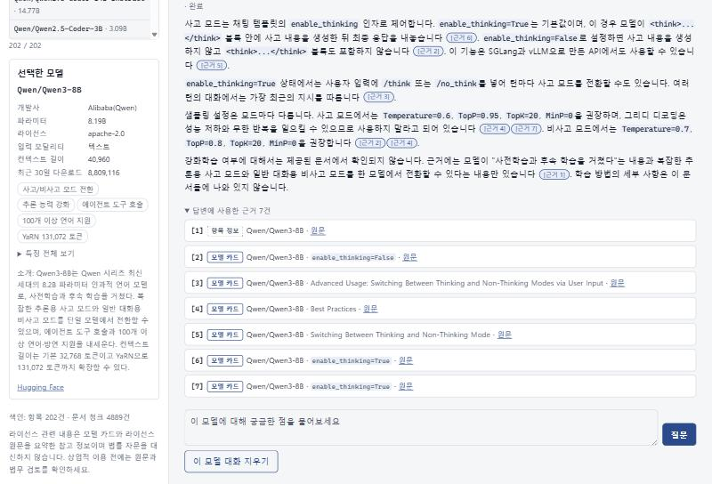
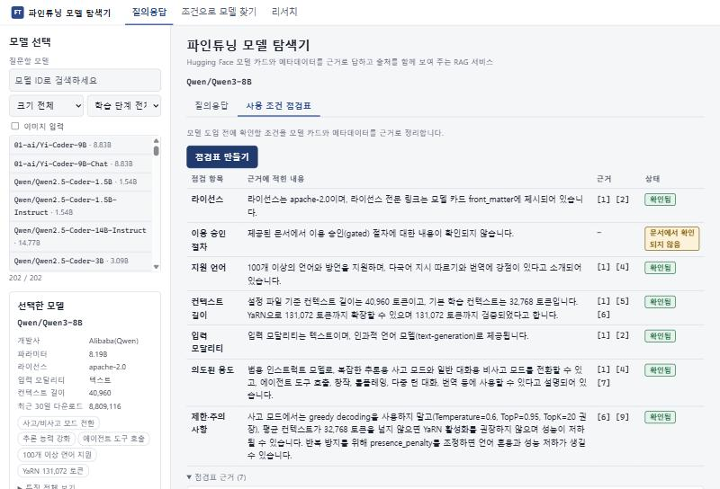
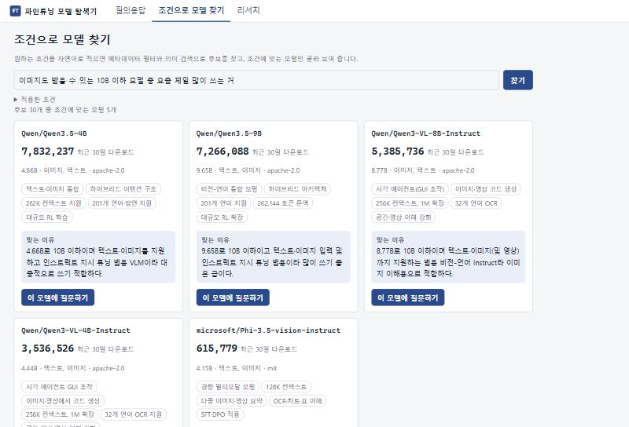
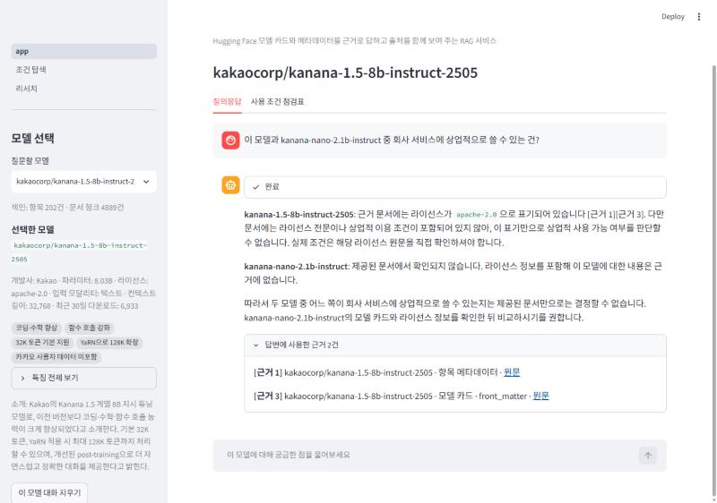

# 파인튜닝 모델 탐색기 (finetune-model-explorer)

Hugging Face 모델 카드와 한국어 위키백과를 근거로, 파인튜닝할 오픈 웨이트 언어 모델에 대해 답하고 출처를 함께 보여 주는 RAG 서비스.

## 해결하려는 문제

업무용으로 파인튜닝할 중간 규모(약 1~24B) 오픈 웨이트 모델을 고를 때는 라이선스, 이용 승인 절차, 지역 제한, 컨텍스트 길이, 지원 언어처럼 **조건과 수치**를 정확히 알아야 한다. 이런 정보는 모델·버전마다 다르고, LLM 학습 이후에 나온 모델도 많아 근거 없이 답하면 그럴듯하게 틀린다.

| 질문 예시 | 근거 없이 답하면 |
|---|---|
| kanana-1.5-8b-instruct와 kanana-nano-2.1b-instruct 중 상업적으로 쓸 수 있는 건? | 같은 계열이라 같은 라이선스로 추측하기 쉽지만 실제로는 Apache-2.0과 CC BY-NC 4.0(비상업)으로 갈린다 |
| Gemma 3 4B-it의 최대 컨텍스트 길이는? | 입력 128K·출력 8192를 따로 표기한 카드와 달리 "합계 128K"로 섞어 답한다 |
| Llama 3.2 11B Vision을 이미지 입력용으로 쓸 때 지역 제한이 있나? | 내용은 맞혀도 어느 문서의 어느 조항인지 근거를 대지 못한다 |
| 최근 공개된 모델의 파라미터 수와 MoE 여부는? | 학습 이후 모델은 모르거나 이전 버전 수치로 답한다 |

이 서비스는 모델 하나를 고르면 **그 모델의 문서 범위 안에서만** 근거를 찾아 답하고, 답변에 인용한 근거 번호와 원문 링크를 함께 보여 준다. 문서에 없으면 "제공된 문서에서 확인되지 않습니다"라고 답한다.

> 라이선스 관련 답변은 참고 정보이며 법률 자문을 대신하지 않는다는 안내를 화면에 표시한다.

## 데모 화면

**질의응답 (웹 화면)** — 답변의 `[근거 n]`과 "답변에 사용한 근거" 목록. 근거마다 출처 종류(항목 정보·모델 카드·위키백과)와 원문 링크가 붙는다.



**사용 조건 점검표** — 라이선스·이용 승인·지원 언어·컨텍스트 길이 등 도입 전에 확인할 항목을 근거와 상태(확인됨 / 문서에서 확인되지 않음)로 정리한다.



**조건으로 모델 찾기** — "이미지도 받을 수 있는 10B 이하 모델 중 요즘 제일 많이 쓰는 거" 같은 자연어 조건을 메타데이터 필터·정렬로 바꿔 후보를 찾고, 맞는 모델만 이유와 함께 보여 준다.



**RAG 효과 (Streamlit 화면)** — 근거 없이 물으면 "둘 다 상업적 사용 허용"이라고 틀리게 답하던 질문에, 메타데이터·카드 머리말을 근거로 답하고 범위 밖 모델은 확인되지 않는다고 답한다.



다크 모드·모바일 화면: [web-dark.png](docs/reports/screenshots/web-dark.png), [web-mobile.png](docs/reports/screenshots/web-mobile.png)

## 주요 기능

| 기능 | 내용 |
|---|---|
| 모델별 질의응답 | 모델 202개 중 하나를 골라 질문. 항목 메타데이터 + 모델 카드 + 위키백과에서 근거를 찾아 답하고, 인용한 근거만 목록으로 보여 준다. 모델별로 대화를 따로 유지한다 |
| 사용 조건 점검표 | 라이선스·이용 승인·지원 언어·컨텍스트 길이·입력 모달리티·의도된 용도·제한 사항 7항목을 근거 번호와 상태로 정리 |
| 조건 기반 탐색 | 자연어 조건 → 필터·정렬 변환 → 의미 검색 후보 → 조건에 맞는 모델만 선별 |
| 질문 시점 문서 수집 | 질문에서 검색어를 뽑아 한국어 위키백과 후보를 고르고 수집·색인. 이미 수집한 문서는 다시 받지 않는다 |
| 두 가지 화면 | Streamlit 화면과 FastAPI + HTML/CSS/JS 웹 화면(다크 모드·반응형). 같은 모듈을 쓴다 |
| 검색 방식 전환 | 설정 하나로 유사도 ↔ MMR 검색 |

기능 번호(F2001~, NF2001~)와 구현 위치는 [기능 정의](docs/reports/features.md)에 있다.

## 구조

```
질문 ─▶ P1 검색어 추출 ─▶ 위키 후보 검색 ─▶ P2 문서 선별 ─▶ 수집·청킹·색인 (질문 시점)
                │
                ▼
        LangGraph retrieve ─────────────────────────▶ generate (P3 답변, 스트리밍)
        · 항목 청크 1개 (항상 [근거 1])                · 근거만으로 답하고 [근거 n] 인용
        · 모델 카드: 영어 검색 문구로 card_k=6       · 인용된 근거만 화면에 표시
        · 위키: 원래 질문으로 wiki_k=2
        · 모두 선택 모델(model_id) 범위로 필터
```

- **Vector Store:** Chroma 컬렉션 2개 — `items`(모델당 1청크, 메타데이터 필터용 필드 포함), `docs`(모델 카드·위키 청크, 출처 종류·섹션·원문 URL·카드 리비전).
- **임베딩:** 로컬 `BAAI/bge-m3` (한국어 질문 ↔ 영어 카드 교차 검색).
- **LLM:** Anthropic API — 답변·검색어 추출·문서 선별은 claude-haiku-5-5(thinking 끔), 모델 소개 요약(데이터 준비)은 claude-sonnet-5-5. 작업별 모델은 `config/llm.json`과 환경 변수로 바꾼다.
- **데이터 준비:** Hugging Face Hub API로 모델 202개 메타데이터 수집 → 모델 카드(리비전 고정) 수집 → 카드 머리말·섹션 정리 → 소개 요약 생성 → 색인.

자세한 흐름, 메타데이터, 프롬프트, 청크 설정과 그 근거는 [RAG 파이프라인 구조](docs/reports/architecture.md)에 있다.

## 평가로 개선한 과정

카드 검색 평가 세트(6개 모델 · 33개 사례 × 같은 뜻의 질문 표현 3개 = 99개)를 만들고, 사례마다 정답 조각(청크 ID)을 미리 정해 두었다. 저장한 검색 문구로 검색을 재현해 LLM 호출 없이 적중을 잰다 (`scripts/eval_retrieval.py`). 답변 단위로는 사례별 핵심 사실 채점 기준(`answer_rubric.jsonl`)으로 비교했다.

| 문제 | 원인 | 조치 | 결과 |
|---|---|---|---|
| 한국어 질문에서 근거가 모두 한국어 위키 청크로 채워지고 영어 모델 카드가 빠짐 | 한 컬렉션을 한국어 질문 하나로 검색하면 같은 언어 청크가 상위를 차지 | **출처별 분리 검색**: 카드는 P1이 만든 영어 문구로, 위키는 원래 질문으로 따로 검색. 위키가 모자라도 카드로 채우지 않음 | 같은 질문의 근거: 항목 1 + 위키 5(카드 0) → 항목 1 + 카드 4 + 위키 2 |
| 카드 근거 자리를 Citation·Contributors 같은 섹션이 차지 | 저가치 섹션도 영어 검색 문구와 유사도가 높음 | 저가치 소제목(`chunk.exclude_sections`) 청크를 색인에서 제외, 카드 머리말(라이선스·이용 조건 키)을 별도 청크로 색인 | 머리말에만 있던 Llama 3.2 Vision EU 제한 조항을 근거로 답하게 됨 |
| 정답 조각이 5~6위에 걸려 빠짐 | `card_k=4` 경계 | **card_k 4 → 6** | 검색 적중 90/99 → 96/99, 답변 정답 31/33 → 33/33 (나빠진 사례 0), 입력 토큰 중앙값 +26% |
| 같은 질문인데 표현에 따라 EU 제한을 답하기도, "확인되지 않습니다"로 답하기도 함 | 검색 문구 하나에 결과가 좌우됨. 이전 P1 모델(gpt-5.4-nano)은 "지역 제한"을 "regional availability image input"으로 옮겨 EU 조각이 24위 | **P1 모델을 claude-haiku-5-5로 교체** | 같은 표현을 "image input region restriction …"으로 옮겨 EU 조각 1~2위, 5회 반복 5/5 적중. 앱에서 근거 번호와 함께 답함 |
| 카드 안 비슷한 문단 쏠림 우려 | — | **MMR 비교** (fetch 30, λ 0.5) | MMR 적중 72/99 대 유사도 90/99 (놓침으로 바뀐 것 18건, 새로 적중 0건) → 기본은 유사도, MMR은 설정으로 전환 |

그 밖에 검증한 것:
- **프롬프트 개정 판정:** P1 v0.4 후보는 전체 적중 188/198로 v0.3(189/198)보다 낮고 일부 사례가 줄어 채택하지 않았다.
- **thinking 끄기:** claude-haiku-5-5의 thinking을 끄자 정답 수는 같고 출력 토큰 중앙값 727 → 303, 첫 글자 3.22초 → 1.24초.
- **응답 시간:** 병목은 답변 생성 43%, 문서 선별 22%, 검색어 추출 12%. 문서 선별 병렬화(첫 질문당 2.7~9.1초 단축), 임베딩 모델 미리 적재(첫 질문 약 6초 단축)를 적용했다. Anthropic API 직접 호출 기준 Streamlit 첫 질문 중앙값 12.90초, 이어지는 질문 2.19초(첫 글자 1.06초)로 목표(15초 / 40초) 안이다.
- **RAG 전후 비교:** 대표 질문 5개에서 근거 없이 틀리거나 근거를 대지 못하던 답을 RAG가 근거 번호와 함께 바로잡았다.

상세: [검증 결과](docs/reports/evaluation.md) · [RAG 전후 비교](docs/reports/rag-vs-no-rag.md) · [성능 조사](docs/reports/performance.md)

## 개발 방식

이 프로젝트는 AI 도구와 역할을 나눠 개발했다. 기획과 결정, 검증은 직접 하고, 구현은 Claude Code에 맡겼다.

| 역할 | 담당 |
|---|---|
| 문제 정의, 도메인 선정, 기능 범위, 설계 결정 | 직접 (Claude와 논의하며 정하고 [결정 기록](docs/design/decisions.md)에 남김) |
| 구현 | Claude Code에 단계별 작업 지시문으로 위임 |
| 검증과 채택 판단 | 직접 (테스트, 평가 세트, 미리 정한 채택 규칙) |

**작업 지시 방식** — 지시문마다 배경, 작업, 금지 사항, 보고 형식을 정했다. 금지 사항에는 원본 데이터·색인 수정, 비밀 값 출력, 결과를 본 뒤 평가 기준 바꾸기 등을 넣었다. 보고를 읽고 다음 결정을 내리는 과정을 반복했다.

**AI가 만든 결과를 그대로 받지 않기 위한 장치**
- 단위 테스트 41개: 인용 추출, 출력 잘림 처리, 대화 기록 정리, 화면 이스케이프 등
- 카드 검색 평가 세트 99개 질의: 정답 조각을 결과를 보기 전에 정해 두고, 설정을 바꿀 때마다 수치로 비교
- 채택 규칙을 실행 전에 정함: 검색 개선 후보 3가지와 검색어 추출 프롬프트 개선안은 일부 사례를 나빠지게 해 채택하지 않았다
- 답변 품질 비교는 어떤 설정의 답인지 가린 채 채점

**직접 내린 주요 판단** ([결정 기록](docs/design/decisions.md)과 각 설계 문서)
- 모델 카드 근거가 빠지는 문제를 출처별 분리 검색으로 해결 ([RAG 파이프라인 구조](docs/reports/architecture.md))
- 카드 머리말에만 있는 이용 제한 문구를 색인 대상에 포함 ([컬렉션과 메타데이터 설계](docs/design/collections.md))
- 임베딩은 로컬 모델, 답변 모델은 품질과 비용을 비교해 선택 ([모델 선택](docs/design/models.md))
- 모델 카드 원문과 색인은 저장소에 올리지 않고(게이트 카드의 라이선스 동의 절차와 카드 저작권 때문), 리비전 고정 재수집으로 재현성 확보 ([결정 기록](docs/design/decisions.md))
- 성능 목표는 중앙값으로 판정 (외부 API 응답 변동이 커서, [검색 설정과 화면 설계](docs/design/retrieval-and-ui.md))

## 실행 방법

Python 3.12, Windows 기준 명령이다 (macOS·Linux는 `.venv/bin/python`). **프로젝트 루트에서 실행한다.** Chroma 1.5.9는 ASCII가 아닌 절대 경로에 저장한 색인을 다시 읽지 못해, 경로에 한글이 있으면 상대 경로(`data\chroma`)로 색인을 연다. 다른 위치에서 실행하면 `CHROMA_DIR`에 ASCII 경로를 지정한다.

### 설치

```bash
git clone https://github.com/TimeLinear/finetune-model-explorer.git
cd finetune-model-explorer
python -m venv .venv
.venv\Scripts\python.exe -m pip install -r requirements.lock.txt
```

- `requirements.lock.txt`는 간접 의존성까지 고정한 목록이다. 직접 의존성만 설치하려면 `requirements.txt` (torch는 PyPI CPU 빌드).
- `.env.example`을 `.env`로 복사하고 값을 채운다 (아래 환경 변수).

### 데이터 준비와 색인

```bash
.venv\Scripts\python.exe scripts\fetch_cards.py      # 모델 카드 202개를 manifest 리비전으로 받고 본문 해시를 대조
.venv\Scripts\python.exe scripts\build_index.py      # 항목(202) + 모델 카드 청크 색인
```

- 첫 색인 때 임베딩 모델(`BAAI/bge-m3`, 약 2.2GB)을 받는다. CPU에서 색인은 약 30분 걸린다.
- 게이트 모델(Llama, Gemma 등)의 카드는 해당 저장소에서 라이선스에 동의한 계정의 `HF_TOKEN`이 있어야 받을 수 있다.
- 모델 소개 요약(`data/summaries.jsonl`)은 저장소에 들어 있어 다시 만들 필요가 없다.
- `build_index.py`는 다시 실행해도 청크 수가 늘지 않는다. 위키백과 문서는 질문할 때 수집·색인된다.

### Streamlit 화면

```bash
.venv\Scripts\python.exe -m streamlit run app.py     # http://localhost:8501
```

### 웹 화면

```bash
.venv\Scripts\python.exe -m uvicorn web.api:app --host 127.0.0.1 --port 8000     # http://127.0.0.1:8000
```

- 같은 Chroma 색인을 쓰므로 Streamlit과 동시에 띄우지 않는다.
- API: `GET /api/status`(색인 수, 키 유무, 프로필), `GET /api/models`, `GET /api/models/{model_id}`, `POST /api/chat`(text/event-stream), `POST /api/explore`, `POST /api/usage-check`.
- 서버는 대화 상태를 갖지 않는다. 모델별 대화 기록은 브라우저에 두고, 질문할 때 최근 몇 턴만 함께 보낸다.

### 테스트

```bash
.venv\Scripts\python.exe -m unittest discover -s tests -v
```

LLM·외부 API를 호출하지 않는다. 검색 평가: `.venv\Scripts\python.exe scripts\eval_retrieval.py --label my_check`

커밋 전 검사 훅 연결 (clone 후 한 번): `git config core.hooksPath .githooks` — 커밋할 때마다 `scripts/precommit_check.py`가 스테이징된 파일의 비밀 값·키 형태·제외 대상 경로를 검사한다.

### 환경 변수

| 이름 | 용도 |
|---|---|
| `ANTHROPIC_API_KEY` | Anthropic API 키 (임베딩은 로컬 모델이라 키가 필요 없다) |
| `HF_TOKEN` | Hugging Face 읽기 토큰 (게이트 저장소 조회) |
| `WIKI_CONTACT` | 위키백과 API User-Agent에 넣을 연락처 (위키미디어 요구사항) |
| `APP_SETTINGS` | (선택) 다른 설정 파일 경로. 비우면 `config/settings.json` |
| `CHROMA_DIR` | (선택) 색인 폴더. 비우면 `data/chroma` |
| `LLM_PROFILE` | (선택) LLM 프로필 이름. 비우면 `config/llm.json`의 `active_profile` (`anthropic_direct`) |
| `LLM_SUMMARY` / `LLM_SMALL` / `LLM_ANSWER` | (선택) 작업별 모델 교체, 예: `anthropic:claude-sonnet-5-5` |

API 키는 환경 변수로만 다루고 소스코드·문서·로그에 남기지 않는다. 오류 상세는 화면에 보이지 않고 `logs/app.log`에만 남는다. 요청별 단계 시간·토큰은 `logs/perf.jsonl`에 기록된다.

## 데이터 출처와 이용 조건

**항목(모델) 목록:** `data/items_20261021.json` / `.csv` — 2026-10-21 스냅샷 202개.
- 모델을 만든 회사·연구소의 공식 Hugging Face 계정 28곳(한국 8곳 포함)만. 커뮤니티 파인튜닝·양자화 재업로드·머지 모델 제외.
- 전체 파라미터 1~24B, 베이스와 인스트럭트 모두. 보상·안전 분류·임베딩·음성 모델 제외.
- 최근 30일 다운로드로 그룹 안에서 순위를 매겨 선별: 범용 상위 18%(134), 특수 목적(코드·수학·문서·의료·번역) 상위 30%(40), 한국 상위 50%(28).
- 아키텍처·컨텍스트 길이는 기계 판독 출처(config.json, 없으면 transformers 기본값)만 쓰고 출처를 `context_source`로 남긴다. "상업적 이용 가능 여부" 같은 판정은 저장하지 않고 질문 시점에 원문을 근거로 답한다.

| 출처 | 용도 | 이용 조건 | 지키는 방법 |
|---|---|---|---|
| Hugging Face 모델 카드 | 주 문서 출처 (항목과 1:1) | Hugging Face 이용약관, 저장소별 라이선스 | 청크마다 원문 URL·카드 리비전 저장, 근거는 발췌와 링크로만 표시. **카드 원문과 색인은 저장소에 올리지 않고** `data/cards/_manifest.json`(리비전·URL·본문 해시)만 올린다 |
| 게이트 저장소 (Llama, Gemma 등) | 카드·설정 파일 조회 | 저장소별 라이선스 동의 | 동의한 계정 토큰으로만 조회, 가중치는 받지 않음 |
| Hugging Face Hub API | 항목 메타데이터 | Hugging Face 이용약관 | 호출 간격·재시도 제한·식별 가능한 User-Agent |
| 한국어 위키백과 | 개념·계열 설명 (보조) | CC BY-SA 4.0 | 제목·URL 출처 표시, User-Agent에 연락처 포함 |

- 모델 소개 요약(`data/summaries.jsonl`)은 각 모델 카드를 LLM으로 요약한 것이며, 카드 URL·리비전·생성 모델을 함께 기록했다.
- 검색 평가 세트(`tests/retrieval_eval/`)의 근거 문장은 각 모델 카드에서 짧게 인용했으며, 저작권과 라이선스는 해당 모델 개발 조직에 있다.

## 로드맵

1. **데이터 갱신:** 지금은 2026-10-21 스냅샷으로 고정. 진입·퇴출 기준을 분리하고(퇴출은 더 느슨한 기준을 연속으로 못 넘을 때만), 대화 기록이 있는 모델은 퇴출에서 빼고, 퇴출은 삭제가 아니라 "보관"으로 처리하는 주 1회 (설정으로 변경 가능, [data-refresh.md](docs/design/data-refresh.md)) 갱신. 필요한 필드(`status`, `first_seen`, `last_qualified`, `snapshot_date`)는 미리 넣어 두었다.
2. **웹 배포:** 웹 화면을 공개 서버에 배포 (색인 생성·보관 방식, 요청 제한, 비용 상한 포함).
3. **파인튜닝 후보 리서치:** 사용자가 자기 도메인의 특징과 예시를 입력하면 파인튜닝 후보 3~5개를 근거와 함께 제시. "최적 모델 판정"이 아니라 "후보 선별 + 근거 제시"까지만 한다 (실제 파인튜닝 성능은 돌려 보기 전에 알 수 없고, 카드의 벤치마크는 대부분 개발사 자체 보고 수치이기 때문). 여러 모델 비교 리포트, 리서치 노트 저장·내보내기 포함. 화면 자리(`pages/2_리서치.py`, `research.html`)만 있다.

남은 작업은 [할 일 목록](docs/design/backlog.md)에서 관리한다.

## 문서

모든 문서의 목록·상태와 작업별로 읽을 문서는 [문서 지도](docs/README.md)에 있다. 핵심 문서:

| 문서 | 내용 |
|---|---|
| [개발 방식](#개발-방식) | AI 도구와의 역할 분담, 작업 지시 방식, 검증 장치 (이 README의 절) |
| [기능 정의](docs/reports/features.md) | 기능(F)·비기능(NF) 번호, 설명, 구현 위치, 상태 |
| [RAG 파이프라인 구조](docs/reports/architecture.md) | 데이터·색인·검색·생성 흐름, 설정 근거, 겪은 문제와 해결 |
| [검증 결과](docs/reports/evaluation.md) | 기능별 테스트 결과, 평가 세트 결과, 기능 대조표, 확장 기능 비교 |
| [결정 기록](docs/design/decisions.md) | 설계 결정과 바뀐 과정 (날짜순) |
| [할 일 목록](docs/design/backlog.md) | 로드맵 순서의 남은 작업 |
